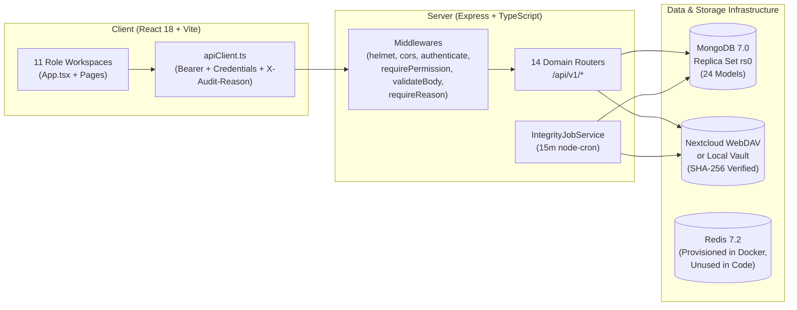
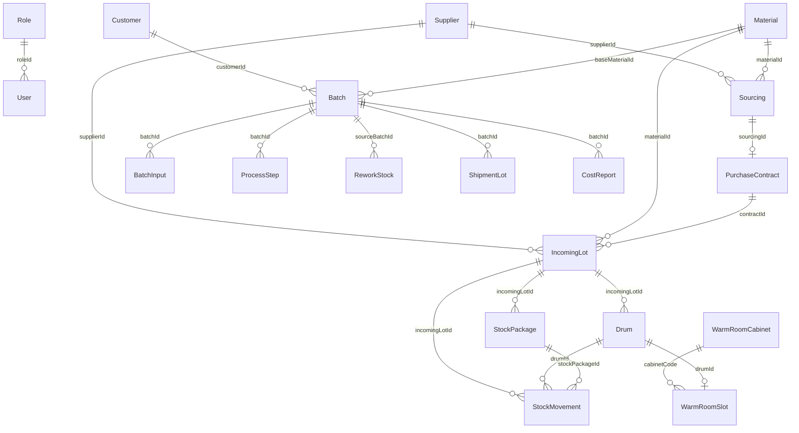

# BURAMLOOP ERP — Comprehensive Technical Audit & Remediation Tracker

**Document Version:** `v1.3` (Audit & Traceability Upgrades & System Governance Decoupling)
**Initial Audit Date:** 2026-11-04 (`v1.0` — Read-Only Inspection)
**Last Updated:** 2026-11-06 (`v1.3` — `BL-051`–`BL-055` Verified)
**Scope:** End-to-end inspection and ongoing monitoring of `shared`, `server`, `client`, `docker-compose.yml`, and build/test pipelines.

---

## 0. Version & Remediation Timeline

| Version | Date | Context / Issue Ref | Summary of Changes & Verification Status |
| :--- | :--- | :--- | :--- |
| **`v1.0`** | 2026-11-04 | Initial Audit | Completed 100% read-only inspection across `shared`, `server`, `client`, and `docker-compose.yml`. Identified 3 Critical (`CRIT-01`–`CRIT-03`), 8 High (`HIGH-01`–`HIGH-08`), 6 Medium (`MED-01`–`MED-06`), and 2 Low (`LOW-01`–`LOW-02`) findings. |
| **`v1.1`** | 2026-11-04 | [`ctx-v63`](./CONTEXT_HISTORY.md) / [`BL-049`](./ISSUES_AND_FIXES.md#resolved) | Completed **Phases 1, 2, and 3** (`CRIT-01`–`CRIT-03`, `HIGH-01`–`HIGH-08`, `MED-01`, `MED-04`, `LOW-01`). Verified with `tsc --noEmit` across `shared`, `server`, and `client` (0 errors) and 11 server Jest unit suites (48 tests passing). |
| **v1.3** | 2026-11-06 | [`ctx-v70`–`ctx-v71`](./CONTEXT_HISTORY.md) / [`BL-054`–`BL-055`](./ISSUES_AND_FIXES.md#resolved) | German DIN 1333/5008 standards, 4-language traceability (DE, TR, EN, BN), HonigV lab surfacing, atomic IFS Regulatory Hold, decoupled 4-tab Admin Audit & Compliance workspace with visual key diffs, in-app audio chimes, native PWA push, and dynamic API envelope resilience. Verified with 15 server Jest suites (57 tests passing) and client production build. |
| **`v1.2`** | 2026-11-04 | [`ctx-v64`](./CONTEXT_HISTORY.md) / [`BL-050`](./ISSUES_AND_FIXES.md#resolved) | Completed **Phase 4** (`HIGH-07` auth rate limiting, `MED-02` Docker `server` Redis decoupling, `MED-03` in-memory/cookie JWT storage, `MED-05` `.limit(500)` query bounds, `MED-06` bounded parallel WebDAV integrity checks, and `LOW-02` Vite vendor/scanner manual chunk splitting). All 19 audit items (`CRIT`, `HIGH`, `MED`, `LOW`) are now **RESOLVED**. |

---

## 1. Executive Summary & Overall Development Status

**BURAMLOOP** is a domain-specific Honey Operations & End-to-End Government Traceability ERP built for **Buram GmbH (Hennigsdorf, Germany)** as a TypeScript `pnpm` monorepo (`shared`, `server`, `client`).

### Static Analysis, Build & Test Verification Results

| Verification Check | Command Executed | v1.0 Baseline (Pre-Fix) | v1.1 Current Status (Post-Fix `BL-049`) |
| :--- | :--- | :--- | :--- |
| **Shared Typecheck** | `tsc -p shared/tsconfig.json --noEmit` | **PASS (Exit 0)** | **PASS (Exit 0)** |
| **Server Typecheck** | `tsc -p server/tsconfig.json --noEmit` | **PASS (Exit 0)** | **PASS (Exit 0)** |
| **Client Typecheck** | `tsc -p client/tsconfig.json --noEmit` | **PASS (Exit 0)** | **PASS (Exit 0)** |
| **Client Production Build** | `vite build` | **PASS (Exit 0)** | **PASS (Exit 0)** |
| **Server Jest Unit Suites** | `pnpm --filter @buramloop/server test` | **11 Suites PASS (47 tests)** | **15 Suites PASS (57 tests)** *(includes `MongoMemoryReplSet` E2E workflows and `german-standard-trace-hold.test.ts`)* |

---

## 2. Project Architecture & Infrastructure Assessment

### 2.1 Monorepo Structure
- **[package.json](../package.json) & [pnpm-workspace.yaml](../pnpm-workspace.yaml):** Manages `@buramloop/shared`, `@buramloop/server`, and `@buramloop/client` with Node `>=20.0.0` and `pnpm@9`.
- **`shared/` ([shared/src/index.ts](../shared/src/index.ts)):** Exports shared Zod schemas, domain enums, origin percentage blending math ([origin-blend.ts](../shared/src/schemas/origin-blend.ts)), and package weight distribution utilities.
  - **Architecture Note:** Both `server` and `client` import directly from `../../../shared/src/...` via relative paths rather than `@buramloop/shared` workspace package imports. Because of this, [server/tsconfig.json](../server/tsconfig.json) sets `rootDir: ".."` and outputs compiled server code at `dist/server/src/server.js`.
- **`server/` ([server/src/app.ts](../server/src/app.ts), [server/src/server.ts](../server/src/server.ts)):** Express 4 + Mongoose 8 backend with modular domain services (`auth`, `master`, `sourcing`, `stock`, `attachment`, `batch`, `warm-room`, `process`, `shipment`, `cost`, `trace`, `export`, `notification`, `audit`), WebDAV Nextcloud/local storage providers, and a 15-minute `node-cron` integrity job.
- **`client/` ([client/src/App.tsx](../client/src/App.tsx)):** React 18 + Vite 5 + Tailwind CSS + Lucide + `@zxing/browser` + `tesseract.js` single-page application using state-based workspace switching (`activeModule: ModuleKey`).

### 2.2 Infrastructure & Workspace Hygiene Assessment
- **[docker-compose.yml](../docker-compose.yml):**
  - Provisions 6 services: `mongodb` (`mongo:7.0` with `--replSet rs0`), `mongo-init-replica` (one-shot `rs.initiate`), `redis` (`redis:7.2-alpine`), `nextcloud` (`nextcloud:29-apache`), `server`, and `client` (Nginx on port `3000` -> `80`).
  - **Unused Redis Service (`MED-02` — Open):** `redis` and `REDIS_URL` are provisioned in `docker-compose.yml` and validated in `env.ts`, and `ioredis` is listed in `server/package.json`, but zero files in `server/src/` currently import or use Redis.
- **Stray / Dead Files Cleanup (`HIGH-04` — Resolved in `v1.1`):**
  - Removed 16 zero-byte placeholder files in `client/src/pages/` and `client/src/components/`, 2 zero-byte files in `server/src/modules/notification/`, and the duplicate nested `client/client/src` directory tree.

---

## 3. Complete API Endpoint & Routing Inventory (Updated `v1.1`)

All 62 active route registrations traced from [server/src/app.ts](../server/src/app.ts) through every module router, middleware chain, controller, service, and frontend caller:

| # | Method & Full Path | Auth & RBAC | Body Validation (`validateBody`) | Audit Reason (`requireReason`) | Controller → Service | v1.1 Verification Status |
| :--- | :--- | :--- | :--- | :--- | :--- | :--- |
| 1 | `GET /api/v1/health` | Public | N/A | No | Inline in `app.ts` | **FIXED (`v1.1`):** Deduplicated single registration. |
| 2 | `GET /api/v1/health/storage` | Public | N/A | No | Inline in `app.ts` | **FIXED (`v1.1`):** Deduplicated single registration; `App.tsx` wired to `/health/storage`. |
| 3 | `GET /api/v1/health/full` | `authenticate` + `requireAdminOnly` | N/A | No | Inline in `app.ts` | **FIXED (`v1.1`):** Protected with `authenticate` + `requireAdminOnly`; notification enum crash resolved. |
| 4 | `POST /api/v1/auth/login` | Public | `LoginRequestSchema` | No | `authController.login` | Active (rate limiting tracked under `HIGH-07`). |
| 5 | `POST /api/v1/auth/logout` | `authenticate` | None | No | `authController.logout` | Active. |
| 6 | `GET /api/v1/auth/me` | `authenticate` | N/A | No | `authController.me` | Active. |
| 7 | `PATCH /api/v1/auth/profile` | `authenticate` | `UpdateOwnProfileSchema` | No | `authController.updateProfile` | Active. |
| 8 | `POST /api/v1/auth/profile/avatar` | `authenticate` | Multer (5 MB image) | No | `authController.uploadAvatar` | Active. |
| 9 | `GET /api/v1/auth/profile/avatar` | `authenticate` | N/A | No | `authController.downloadOwnAvatar` | Active. |
| 10 | `GET /api/v1/auth/users/:userId/avatar` | `authenticate` | N/A | No | `authController.downloadUserAvatar` | Active (Owner or Admin). |
| 11 | `PATCH /api/v1/auth/change-password` | `authenticate` | `ChangePasswordRequestSchema` | No | `authController.changePassword` | Active. |
| 12 | `GET /api/v1/auth/users` | `requireAdminOnly` | N/A | No | `authController.listUsers` | Active. |
| 13 | `POST /api/v1/auth/users` | `requireAdminOnly` | `AdminCreateUserAccountSchema` | **Yes** | `authController.createUser` | Active. |
| 14 | `GET /api/v1/master/roles` | `roles:read` \| `master:read` | N/A | No | `masterController.getRoles` | Active. |
| 15 | `POST /api/v1/master/roles` | `requireAdminOnly` | `UpsertRoleBodySchema` | **Yes** | `masterController.saveRole` | **FIXED (`v1.1`):** Added `validateBody(UpsertRoleBodySchema)`. |
| 16 | `PUT /api/v1/master/roles/:id` | `requireAdminOnly` | `UpsertRoleBodySchema` | **Yes** | `masterController.saveRole` | **FIXED (`v1.1`):** Added `validateBody(UpsertRoleBodySchema)`. |
| 17 | `GET /api/v1/master/users` | `users:read` \| `master:read` | N/A | No | `masterController.getUsers` | Active. |
| 18 | `POST /api/v1/master/users` | `requireAdminOnly` | `UpsertUserBodySchema` | **Yes** | `masterController.saveUser` | **FIXED (`v1.1`):** Added `validateBody(UpsertUserBodySchema)`. |
| 19 | `PUT /api/v1/master/users/:id` | `requireAdminOnly` | `UpsertUserBodySchema` | **Yes** | `masterController.saveUser` | **FIXED (`v1.1`):** Added `validateBody` and `tokenVersion` bump on `roleId`/`isActive` change. |
| 20 | `GET /api/v1/master/materials` | `authenticate` | N/A | No | `masterController.getMaterials` | Active. |
| 21 | `POST /api/v1/master/materials` | `master:write` | `UpsertMaterialSchema` | **Yes** | `masterController.saveMaterial` | Active. |
| 22 | `PUT /api/v1/master/materials/:id` | `master:write` | `UpsertMaterialSchema` | **Yes** | `masterController.saveMaterial` | Active. |
| 23 | `GET /api/v1/master/quality-grades` | `authenticate` | N/A | No | `masterController.getQualityGrades` | Active. |
| 24 | `POST /api/v1/master/quality-grades` | `master:write` | `UpsertQualityGradeSchema` | **Yes** | `masterController.saveQualityGrade` | **FIXED (`v1.1`):** Aligned schema (`rank`, grade codes) & added `validateBody`. |
| 25 | `PUT /api/v1/master/quality-grades/:id` | `master:write` | `UpsertQualityGradeSchema` | **Yes** | `masterController.saveQualityGrade` | **FIXED (`v1.1`):** Added `validateBody`. |
| 26 | `GET /api/v1/master/suppliers` | `authenticate` | N/A | No | `masterController.getSuppliers` | Active. |
| 27 | `POST /api/v1/master/suppliers` | `master:write` \| `sourcing:write` | `UpsertSupplierBodySchema` | **Yes** | `masterController.saveSupplier` | **FIXED (`v1.1`):** Added `validateBody`. |
| 28 | `PUT /api/v1/master/suppliers/:id` | `master:write` \| `sourcing:write` | `UpsertSupplierBodySchema` | **Yes** | `masterController.saveSupplier` | **FIXED (`v1.1`):** Added `validateBody`. |
| 29 | `GET /api/v1/master/customers` | `authenticate` | N/A | No | `masterController.getCustomers` | Active. |
| 30 | `POST /api/v1/master/customers` | `master:write` \| `shipments:write` | `UpsertCustomerSchema` | **Yes** | `masterController.saveCustomer` | Active. |
| 31 | `PUT /api/v1/master/customers/:id` | `master:write` \| `shipments:write` | `UpsertCustomerSchema` | **Yes** | `masterController.saveCustomer` | Active. |
| 32 | `GET /api/v1/master/infrastructure` | `authenticate` | N/A | No | `masterController.getInfrastructure` | Active. |
| 33 | `POST /api/v1/master/stock-thresholds` | `master:write` | `UpsertStockThresholdSchema` | **Yes** | `masterController.saveStockThreshold` | Active. |
| 34 | `GET /api/v1/master/counters` | `requireAdminOnly` | N/A | No | `masterController.getCounters` | **FIXED (`v1.1`):** `MasterDataWorkspace.tsx` handles 403 gracefully for non-Admin roles. |
| 35 | `POST /api/v1/master/counters/override` | `requireAdminOnly` | `OverrideCounterBodySchema` | **Yes** | `masterController.overrideCounter` | **FIXED (`v1.1`):** Added `validateBody(OverrideCounterBodySchema)`. |
| 36 | `GET /api/v1/sourcings` | `sourcing:read` + price masking | N/A | No | `sourcingController.list` | Active. |
| 37 | `GET /api/v1/sourcings/leads` | `sourcing:read` + price masking | N/A | No | `sourcingController.listLeads` | Active. |
| 38 | `POST /api/v1/sourcings/leads` | `sourcing:write` \| `master:write` | `CreateSupplierLeadSchema` | **Yes** | `sourcingController.createLead` | Active. |
| 39 | `PATCH /api/v1/sourcings/leads/:id/status` | `sourcing:write` \| `management:approve` | `UpdateSupplierLeadStatusSchema` | **Yes** | `sourcingController.updateLeadStatus` | Active. |
| 40 | `GET /api/v1/sourcings/contracts` | `stock:read` \| `sourcing:read` + price masking | N/A | No | `sourcingController.listShippedContracts` | Active. |
| 41 | `POST /api/v1/sourcings` | `sourcing:write` + price masking | `CreateSourcingSchema` | **Yes** | `sourcingController.create` | Active. |
| 42 | `POST /api/v1/sourcings/:id/gates` | Gate-specific RBAC | `EvaluateSourcingGateSchema` | **Yes** | `sourcingController.evaluateGate` | **FIXED (`v1.1`):** `App.tsx` now supplies required `externalAnalysis` payload. |
| 43 | `POST /api/v1/sourcings/:id/contracts` | `contracts:write` \| `sourcing:write` | `CreateContractFromSourcingSchema` | **Yes** | `sourcingController.createContract` | Active. |
| 44 | `POST /api/v1/sourcings/contracts/:contractId/ship` | `contracts:write` \| `sourcing:write` | Service validation | **Yes** | `sourcingController.markShipped` | Active. |
| 45 | `GET /api/v1/sourcings/prices` | `sourcing:read` + `requireCommercialRole` | N/A | No | `sourcingController.listPrices` | Active. |
| 46 | `POST /api/v1/sourcings/prices` | `sourcing:write` + `requireCommercialRole` | Service validation | **Yes** | `sourcingController.createPrice` | Active. |
| 47 | `GET /api/v1/stock/lots` | `stock:read` + price masking | N/A | No | `StockController.listLots` | **FIXED (`v1.1`):** Added `queryString` sanitization. |
| 48 | `GET /api/v1/stock/packages` | `stock:read` + price masking | N/A | No | `StockController.listStockPackages` | **FIXED (`v1.1`):** Added `queryString` sanitization & `sanitizeCommercialDataForRole`. |
| 49 | `GET /api/v1/stock/drums` | `stock:read` + price masking | N/A | No | `StockController.listDrums` | **FIXED (`v1.1`):** Added `queryString` sanitization & `sanitizeCommercialDataForRole`. |
| 50 | `GET /api/v1/stock/drums/:id/zpl-label` | `stock:read` | N/A | No | `StockController.generateDrumZplLabel` | **FIXED (`v1.1`):** Mounted `BarcodeService.generateDrumZplLabel`. |
| 51 | `GET /api/v1/stock/barcode/:code` | `stock:read` | N/A | No | `StockController.resolveBarcode` | **FIXED (`v1.1`):** Mounted `BarcodeService.resolveBarcode` with price masking. |
| 52 | `GET /api/v1/stock/ledger` | `stock:read` | N/A | No | `StockController.listMovements` | **FIXED (`v1.1`):** Added `queryString` sanitization. |
| 53 | `GET /api/v1/stock/ledger/integrity-check` | `stock:read` \| `audit:read` | N/A | No | `StockController.checkLedgerIntegrity` | Active. |
| 54 | `POST /api/v1/stock/lots/receive` | `stock:write` + price masking | `ReceiveIncomingLotSchema` | **Yes** | `StockController.receiveLot` | Active. |
| 55 | `POST /api/v1/stock/lots/:id/review` | `qa:approve` + price masking | `ReviewIncomingLotQaSchema` | **Yes** | `StockController.reviewLotQa` | **FIXED (`v1.1`):** `DEVIATION_MISMATCH` added to `NOTIFICATION_TYPES`. |
| 56 | `POST /api/v1/stock/lots/:id/return-mismatch` | `stock:write` \| `qa:approve` | `ReturnLotOnMismatchSchema` | **Yes** | `StockController.returnLotOnMismatch` | **FIXED (`v1.1`):** `DEVIATION_MISMATCH` added to `NOTIFICATION_TYPES`. |
| 57 | `GET /api/v1/attachments/health` | `authenticate` | N/A | No | `AttachmentController.health` | **FIXED (`v1.1`):** Mounted health endpoint. |
| 58 | `GET /api/v1/attachments` | `attachments:read` \| `stock:read` \| `trace:read` | N/A | No | `AttachmentController.list` | **FIXED (`v1.1`):** Supports `entityCode` filtering. |
| 59 | `GET /api/v1/attachments/integrity-check` | `audit:read` | N/A | No | `AttachmentController.checkIntegrity` | Active. |
| 60 | `GET /api/v1/attachments/:id/download` | `attachments:read` \| `stock:read` \| `trace:read` | N/A | No | `AttachmentController.download` | **FIXED (`v1.1`):** Wired download action in `AttachmentsPanel`. |
| 61 | `POST /api/v1/attachments/upload` | `attachments:write` \| `stock:write` \| `qa:approve` | Multer + `UploadAttachmentMetaSchema` | **Yes** | `AttachmentController.upload` | **FIXED (`v1.1`):** Auto-derives deterministic `entityId` fallback; `AttachmentsPanel` sends valid `docType`. |
| 62 | `POST /api/v1/attachments/:id/void` | `attachments:void` | `ReasonSchema` | **Yes** | `AttachmentController.voidAttachment` | Active. |
| 63 | `GET /api/v1/batches` (and `/api/v1/production/batches`) | `batches:read` + price masking | N/A | No | `BatchController.list` | Active. |
| 64 | `GET /api/v1/batches/stock-availability` | `batches:read` \| `stock:read` | N/A | No | `BatchController.listStockAvailability` | Active. |
| 65 | `GET /api/v1/batches/rework-available` | `batches:read` \| `rework:read` | N/A | No | `BatchController.listAvailableRework` | Active. |
| 66 | `POST /api/v1/batches/simulate-feasibility` | `batches:read` + price masking | `SimulateFeasibilityBodySchema` | No | `BatchController.simulate` | **FIXED (`v1.1`):** Added `validateBody(SimulateFeasibilityBodySchema)`. |
| 67 | `POST /api/v1/batches/reserve` | `batches:approve` \| `batches:write` | `ReserveBatchBodySchema` | **Yes** | `BatchController.approveAndReserve` | **FIXED (`v1.1`):** Added `validateBody` & stopped mutating `Customer.allowedCountries`. |
| 68 | `GET /api/v1/warm-room` | `warmroom:read` | N/A | No | `WarmRoomController.list` | Active. |
| 69 | `POST /api/v1/warm-room/check-in` | `warmroom:write` | `CheckInDrumBodySchema` | **Yes** | `WarmRoomController.checkIn` | **FIXED (`v1.1`):** Added `validateBody(CheckInDrumBodySchema)`. |
| 70 | `POST /api/v1/warm-room/check-out` | `warmroom:write` | `CheckOutDrumBodySchema` | **Yes** | `WarmRoomController.checkOut` | **FIXED (`v1.1`):** Added `validateBody` & `WARM_READY` to `NOTIFICATION_TYPES`. |
| 71 | `GET /api/v1/production/process` | `processing:read` + price masking | N/A | No | `ProcessController.list` | Active. |
| 72 | `POST /api/v1/production/process/stage` & `/step` | `processing:write` + price masking | `ExecuteStageBodySchema` | **Yes** | `ProcessController.executeStage` | **FIXED (`v1.1`):** Added `validateBody`, `PROCESS_DEVIATION` enum, and non-accumulating `totalInputKg`/`totalFilledKg`. |
| 73 | `GET /api/v1/shipments` | `shipments:read` + price masking | N/A | No | `ShipmentController.list` | **FIXED (`v1.1`):** Added query parameter sanitization. |
| 74 | `POST /api/v1/shipments` | `shipments:write` + price masking | `CreateShipmentLotSchema` | **Yes** | `ShipmentController.create` | **FIXED (`v1.1`):** Enforces cumulative `orderedKg` across all non-void shipment lots of a batch. |
| 75 | `POST /api/v1/shipments/:id/status` | `shipments:write` \| `qa:approve` | `ReleaseOrShipLotSchema` | **Yes** | `ShipmentController.transitionStatus` | Active. |
| 76 | `GET /api/v1/costs` | `reports:read` (Admin/Mgmt) | N/A | No | `CostController.list` | Active. |
| 77 | `POST /api/v1/costs/generate` | `requireAdminOnly` | `GenerateCostReportBodySchema` | **Yes** | `CostController.generate` | **FIXED (`v1.1`):** Added `validateBody(GenerateCostReportBodySchema)`. |
| 78 | `GET /api/v1/trace/:code` | `trace:read` + role redaction | N/A | No | `TraceController.traceByCode` | Active. |
| 79 | `POST /api/v1/exports/run` | `exports:run` | `RunExportSchema` | Optional | `ExportController.runExport` | **FIXED (`v1.1`):** Added `RunExportSchema` normalizing `'DRUMS'`/`'BATCHES'`/`'PRINT'`. |
| 80 | `GET /api/v1/exports/logs` | `exports:run` | N/A | No | `ExportController.listLogs` | **FIXED (`v1.1`):** Sorted by `{ createdAt: -1 }`. |
| 81 | `GET /api/v1/notifications` | `authenticate` | N/A | No | Inline in `notification.routes.ts` | Active. |
| 82 | `PATCH /api/v1/notifications/:id/read` | `authenticate` | None | No | Inline in `notification.routes.ts` | Active. |
| 83 | `GET /api/v1/audit` | `audit:read` + price masking | N/A | No | Inline in `audit.routes.ts` | Active. |

---

## 4. Database Schema, Model, Index & Transaction Assessment

- **Append-Only Ledger & Audit Immutability (`LOW-01` — Resolved in `v1.1`):**
  - Both `StockMovementSchema` ([server/src/models/stock.model.ts](../server/src/models/stock.model.ts)) and `AuditLogSchema` ([server/src/models/auditLog.model.ts](../server/src/models/auditLog.model.ts)) now block `deleteOne`, `deleteMany`, `findOneAndDelete`, `updateOne`, `updateMany`, `findOneAndUpdate`, and `replaceOne`.

---

## 5. Classified Findings Register & Live Status Tracker

| ID | Severity | Type | Title & Location | Status (`v1.1`) | Resolution / Next Action |
| :--- | :--- | :--- | :--- | :--- | :--- |
| **CRIT-01** | **Critical** | **VERIFIED ISSUE** | `NotificationModel` enum mismatch aborts transactions (`WARM_READY`, `DEVIATION_MISMATCH`, `PROCESS_DEVIATION`) | **RESOLVED (`v1.1` / `BL-049`)** | Added `'WARM_READY'`, `'DEVIATION_MISMATCH'`, and `'PROCESS_DEVIATION'` to `NOTIFICATION_TYPES` in `shared/src/schemas/outbound.ts`; covered by unit test in `batch-service.test.ts`. |
| **CRIT-02** | **Critical** | **VERIFIED ISSUE** | Broken Frontend → Backend API calls & silent fake upload fallback (`App.tsx`, `CrossCuttingPanels.tsx`) | **RESOLVED (`v1.1` / `BL-049`)** | Wired `App.tsx` to `/health/storage` and added `GET /attachments/health`; updated `AttachmentsPanel` and `ExportMenu` to use valid schemas, download streams, and error surfacing; added required `externalAnalysis` payload in `App.tsx`. |
| **CRIT-03** | **Critical** | **VERIFIED ISSUE** | `BatchService.approveAndReserveBatch` overwrote `Customer.allowedCountries` master record | **RESOLVED (`v1.1` / `BL-049`)** | Removed `customer.allowedCountries` overwrite in `batch.service.ts` and updated `shipment.service.ts` to honor `batch.allowedCountries` for the batch's customer. |
| **HIGH-01** | **High** | **VERIFIED ISSUE** | `BarcodeService` ZPL label (`GET /stock/drums/:id/zpl-label`) and barcode lookup (`GET /stock/barcode/:code`) were unmounted | **RESOLVED (`v1.1` / `BL-049`)** | Mounted both endpoints on `stock.routes.ts` & `stock.controller.ts` with R9 price masking. |
| **HIGH-02** | **High** | **VERIFIED ISSUE** | Mutating endpoints lacked `validateBody` middleware; user role/active update did not bump `tokenVersion` | **RESOLVED (`v1.1` / `BL-049`)** | Added `validateBody` schemas across `master`, `batch`, `warm-room`, `process`, `cost`, and `export` routes; incremented `tokenVersion` on `roleId`/`isActive` change in `master.service.ts`. |
| **HIGH-03** | **High** | **VERIFIED ISSUE** | Unauthenticated `GET /api/v1/health/full` triggered heavy DB/WebDAV audit and DB writes | **RESOLVED (`v1.1` / `BL-049`)** | Protected `/api/v1/health/full` with `authenticate, requireAdminOnly` in `server/src/app.ts`. |
| **HIGH-04** | **High** | **VERIFIED ISSUE** | Duplicate health route registrations & 23 stray/empty files | **RESOLVED (`v1.1` / `BL-049`)** | Deduplicated `/health` and `/health/storage` in `app.ts` and deleted 18 zero-byte files + `client/client/src`. |
| **HIGH-05** | **High** | **VERIFIED ISSUE** | Shipment lot creation did not check cumulative allocated batch mass across multiple lots | **RESOLVED (`v1.1` / `BL-049`)** | `ShipmentService.createShipmentLot` now sums `orderedKg` across all non-void shipment lots for `batch._id` and enforces `<= remainingBatchKg`. |
| **HIGH-06** | **High** | **VERIFIED ISSUE** | `Batch.totalInputKg` and `Batch.totalFilledKg` accumulated on every stage step | **RESOLVED (`v1.1` / `BL-049`)** | `ProcessService.executeStage` now records initial stage input in `totalInputKg` and latest stage output in `totalFilledKg`. |
| **HIGH-07** | **High** | **POTENTIAL RISK** | NoSQL query operator injection in filter parameters & missing login rate limiting | **RESOLVED (`v1.1` & `v1.2` / `BL-050`)** | Added `queryString(...)` sanitization in `stock.controller.ts` & `shipment.service.ts` (`v1.1`) and `loginRateLimiter` / `passwordChangeRateLimiter` in `auth.routes.ts` (`v1.2`). |
| **HIGH-08** | **High** | **VERIFIED ISSUE** | `MasterDataWorkspace` failed to load materials for non-Admin roles when `/master/counters` returned 403 and only rendered Materials + read-only Counters | **RESOLVED (`v1.1` & `v1.2` / `BL-050`)** | `MasterDataWorkspace.tsx` catches `/master/counters` 403 errors gracefully (`v1.1`) and provides a full 5-tab CRUD UI (`Materials`, `Customers`, `Suppliers`, `Quality Grades`, and `Counters` Admin override) (`v1.2`). |
| **MED-01** | **Medium** | **VERIFIED ISSUE** | Zod vs. Mongoose schema drift on `QualityGrade` and `ExportLog` sort field | **RESOLVED (`v1.1` / `BL-049`)** | Updated `UpsertQualityGradeSchema` in `shared/src/schemas/master.ts` and changed `ExportService.listExportLogs` sort to `{ createdAt: -1 }`. |
| **MED-02** | **Medium** | **VERIFIED ISSUE** | Unused Redis dependency on `server` service in `docker-compose.yml` | **RESOLVED (`v1.2` / `BL-050`)** | Removed unnecessary `redis` startup dependency from `server` in `docker-compose.yml` (retaining `redis` for `nextcloud`). |
| **MED-03** | **Medium** | **POTENTIAL RISK** | Dual JWT storage (`sessionStorage` + `httpOnly` cookie) in `LandingWithLoginPage.tsx` and `apiClient.ts` | **RESOLVED (`v1.2` / `BL-050`)** | Replaced persistent `window.sessionStorage.setItem('buram_jwt', ...)` with in-memory `apiClient.setBearerToken(...)` backed by the `httpOnly` cookie. |
| **MED-04** | **Medium** | **POTENTIAL RISK** | Raw 500 error messages returned to clients in production in `error.middleware.ts` | **RESOLVED (`v1.1` / `BL-049`)** | `errorHandler` now returns a generic message when `statusCode === 500` and `env.NODE_ENV === 'production'`. |
| **MED-05** | **Medium** | **POTENTIAL RISK** | Unbounded collection queries (`find({})` without `.limit()`) in `sourcing`, `stock`, `batch`, and `shipment` services | **RESOLVED (`v1.2` / `BL-050`)** | Added `.limit(500)` bounds on `IncomingLotModel` and `PriceModel` queries in `stock.service.ts` and `sourcing.service.ts`. |
| **MED-06** | **Medium** | **POTENTIAL RISK** | Sequential per-file WebDAV `statFile` in `AttachmentService.verifyStorageIntegrity` | **RESOLVED (`v1.2` / `BL-050`)** | Updated `AttachmentService.verifyStorageIntegrity` to process WebDAV `statObject` checks in bounded concurrent batches of 8. |
| **LOW-01** | **Low** | **POTENTIAL RISK** | Append-only Mongoose pre-hooks on `StockMovement` omitted `updateOne`/`updateMany` | **RESOLVED (`v1.1` / `BL-049`)** | Added `updateOne`, `updateMany`, `findOneAndUpdate`, and `replaceOne` pre-hooks to `StockMovementSchema`. |
| **LOW-02** | **Low** | **POTENTIAL RISK** | Single 603 kB client bundle chunk in Vite production build | **RESOLVED (`v1.2` / `BL-050`)** | Configured `manualChunks` (`vendor` and `scanner`) in `client/vite.config.ts` to separate `@zxing/*` and `tesseract.js` from the main bundle. |

---

## 6. How to Maintain & Update This Audit Document

1. **After each audit or remediation sprint:** Increment the **Document Version** header (`v1.2`, `v1.3`, etc.) and append a row to [Section 0 (Version & Remediation Timeline)](#0-version--remediation-timeline).
2. **Cross-reference with project logs:** Link every version row in Section 0 to its corresponding `ctx-vXX` entry in [`docs/CONTEXT_HISTORY.md`](./CONTEXT_HISTORY.md), dated entry in [`docs/DAILY_LOG.md`](./DAILY_LOG.md), and `BL-XXX` row in [`docs/ISSUES_AND_FIXES.md`](./ISSUES_AND_FIXES.md).
3. **Update status badges in Section 5:** Only mark a finding **RESOLVED** after running `tsc --noEmit` and relevant Jest/build checks, and record the exact verification result.

